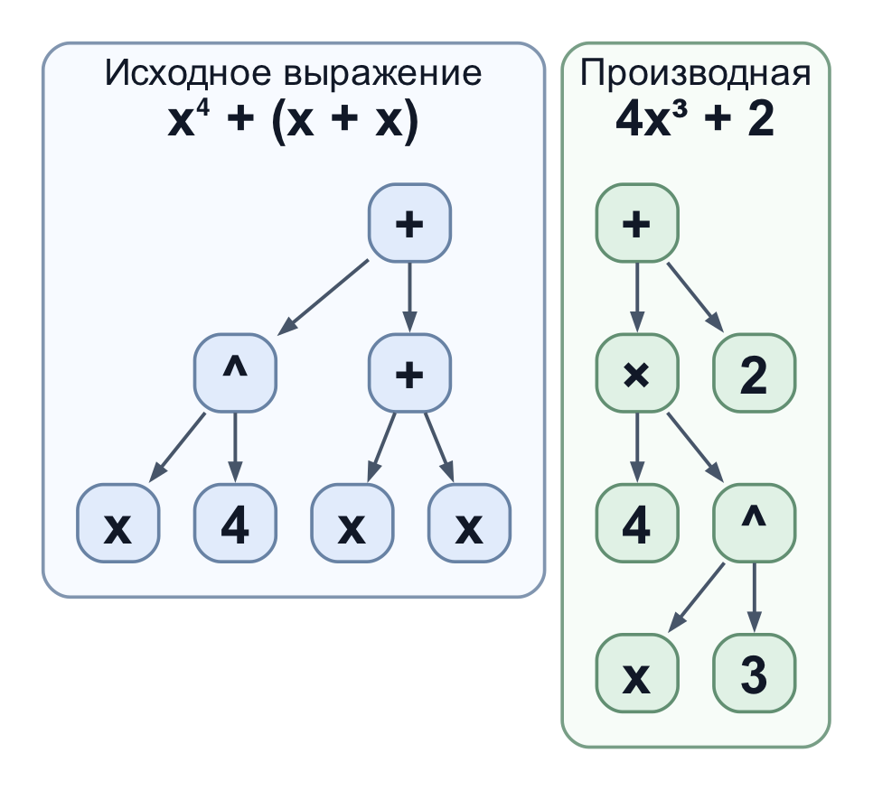

# Differentiator

Учебный проект на C++ для символьного дифференцирования. Программа читает дерево выражения из файла, строит дерево производной, применяет правила упрощения и сохраняет снимки дерева через Graphviz.

## Пример

В [демонстрационном файле](txt/bin_tree.txt) записано дерево выражения `x^4 + (x + x)`. Его математическая производная по `x` равна `4*x^3 + 2`. В самом проекте показаны промежуточные шаги построения и упрощения дерева.



На схеме показаны исходное выражение и упрощённая производная. Деревья, которые сохраняет программа, доступны отдельно.

[Исходное дерево](graph/graph0.png) · [Дерево производной после упрощений](graph/graph10.png) · [Сохранённый DOT-файл](graph/test.dot)

## Что поддерживается

- Операции `+`, `-`, `*`, `/` и возведение в степень.
- Функции `sin`, `cos`, `ln`, `exp` и другие.
- Упрощение дерева по правилам для нулей, единиц и констант.
- Экспорт дерева в DOT и отрисовка через Graphviz.

## Сборка

Makefile собирает программу в `main.exe`. Для сборки нужны компилятор C++17, `make` и подготовленная папка `object_files`. Graphviz нужен для отрисовки деревьев.

Команда для macOS с Apple Clang.

```bash
mkdir -p object_files
make main.exe CXX=c++ CXXFLAGS="-std=c++17 -include cstdlib -DREADABLE_PRINT_BIN_TREE_FILE -I$(xcrun --show-sdk-path)/usr/include/malloc"
```

Graphviz может отрисовать сохранённый DOT-файл.

```bash
dot -Tpng graph/test.dot -o derivative-tree.png
```
